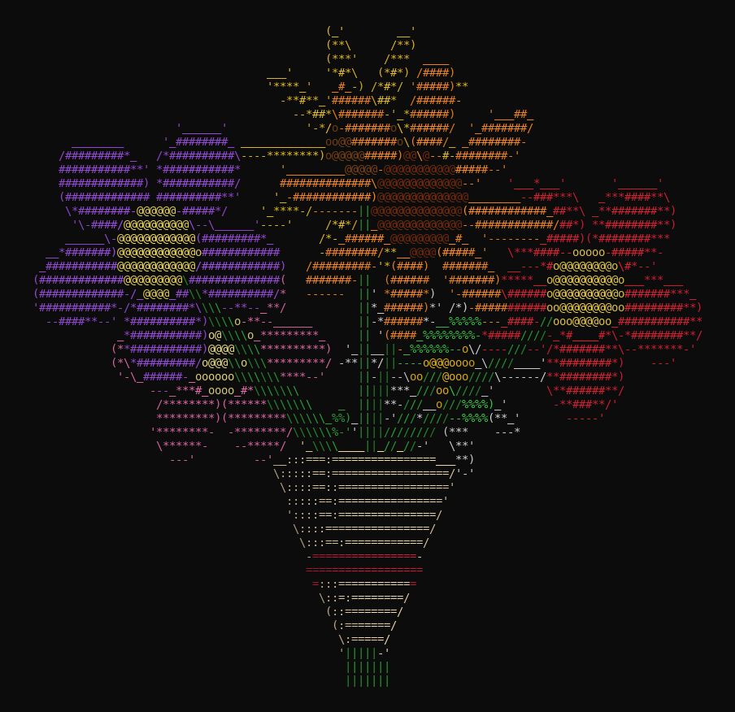

<div align="center">

# 💐 Terminal Bouquet

**A spinning 3D bouquet of flowers that runs right in your command prompt, drawn entirely with colored text characters.**




</div>

## How it works

- The bouquet is built as a 3D model: stems, leaves, a paper wrap with folds and a ribbon, plus six flowers (sunflower, white daisy, red, pink, purple, orange).
- Every frame it's rotated, projected and depth-sorted onto a grid with 8 sub-pixels per character.
- Each character cell is then turned into a symbol: petals get `#` and `*` with `( ) / \ _ -` outlines, centers are `@`, stems are `| / \` lines that follow their direction, leaves are `%`, and the wrap is `:` and `=`.
- Colors are full 24-bit RGB with lighting, so the front of the bouquet is brighter than the back.

## Quick start

```bash
pip install numpy
python bouquet.py
```

Press **Ctrl+C** to stop.

**Tips**
- It resizes to fit your window, so it looks best full screen.
- Zoom out (**Ctrl + minus**) for a more detailed bouquet.
- Use Windows Terminal on Windows for full color.

## License

MIT
